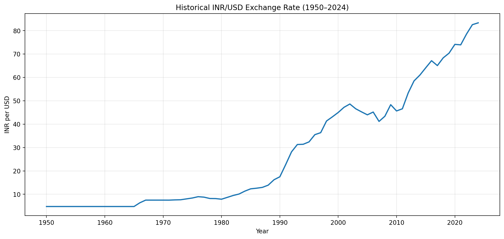
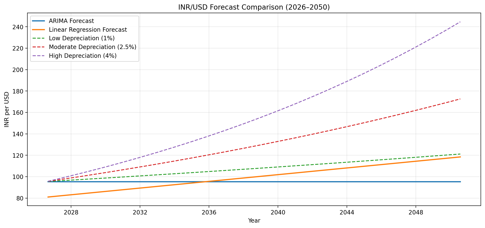
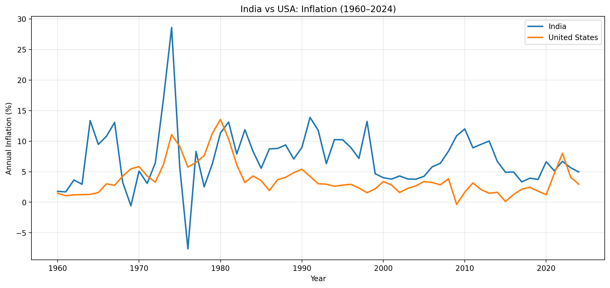

# INR/USD Exchange Rate Analysis and Forecasting (1947–2050)

## Project Overview

This project analyzes historical exchange-rate movements between the Indian rupee (INR) and the US dollar (USD), examines major economic events influencing currency depreciation, and forecasts potential exchange-rate trends through August 2050.

The project also compares economic and social indicators in India and the United States, including inflation, billionaire growth, and happiness scores.

## Technologies Used

- Python
- Jupyter Notebook
- Pandas and NumPy
- Matplotlib and Seaborn
- Scikit-learn
- Statsmodels
- REST API data collection

## Project Features

- Historical INR/USD exchange-rate analysis
- Major rupee devaluation events
- ARIMA time-series forecasting
- Linear Regression forecasting
- Three long-term depreciation scenarios
- Model accuracy evaluation using MAE and RMSE
- India–US inflation comparison
- Billionaire growth comparison
- World Happiness Report analysis

## Forecasting Results

| Model | August 2050 Prediction |
|---|---:|
| ARIMA (1,1,1) | ₹95.30/USD |
| Linear Regression | ₹118.47/USD |

### Model Evaluation

| Metric | ARIMA | Linear Regression |
|---|---:|---:|
| MAE | 6.2093 | 7.6559 |
| RMSE | 7.7054 | 8.1265 |

ARIMA demonstrated lower prediction errors during the selected historical testing period.

## Economic Comparison

The analysis found that the United States experienced lower average inflation and inflation volatility than India over the studied period.

India demonstrated faster percentage growth in billionaire counts between 2023 and 2024, while the United States had higher average life evaluation scores in the World Happiness Report 2024.

## Data Sources

- Federal Reserve Economic Data (FRED)
- Penn World Table 11.0
- Reserve Bank of India (RBI)
- World Bank
- Forbes
- World Happiness Report

## Data Visualizations

### Historical INR/USD Exchange Rate

### INR/USD Forecast Comparison (2026–2050)

### India vs USA Inflation Comparison

## Limitations

The main historical chart covers 1950 through August 2024. Earlier RBI observations require additional verification. Forecasts through 2050 are statistical projections rather than guaranteed exchange rates.

## Author

Independent Python data analysis and forecasting project.
